# WebAuthn.Net.Demo.FidoConformance

This project contains a demo application designed for passing the [FIDO conformance test](https://fidoalliance.org/certification/functional-certification/conformance/).

## How to access the FIDO Conformance Tools

1. On the FIDO Alliance website, open the [Conformance Self‐Validation Testing](https://fidoalliance.org/certification/functional-certification/conformance/) page
2. Find the link to the registration form on the specified page and open it.
3. Fill out the form, specifying that you need access to FIDO2.
4. Wait for an email with further instructions.
5. Download the latest version of the Certification Conformance Testing Tools.

## How to run the FIDO Conformance test

### Prerequisites

These steps need to be performed only if you have not done them before.

1. Install [.NET SDK 10.0.403+](https://dotnet.microsoft.com/en-us/download/dotnet/10.0).
2. [Trust the ASP.NET Core HTTPS development certificate](https://learn.microsoft.com/en-us/aspnet/core/security/enforcing-ssl?view=aspnetcore-10.0&tabs=visual-studio%2Clinux-sles#trust-the-aspnet-core-https-development-certificate)

### Starting the FIDO Conformance test

1. Launch the FIDO Conformance Tools
2. From the available test options, select `"FIDO2 Server Tests"` by clicking the `"RUN"` button on its tile.
   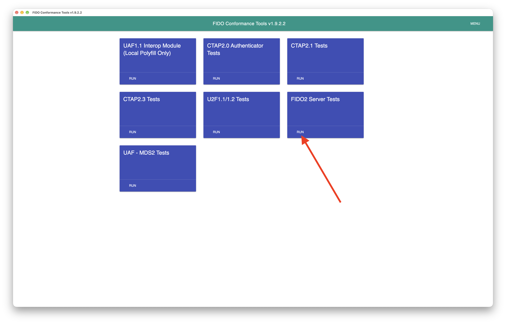
3. In the `"SELECT TESTS TO RUN"` section, enable all available options
   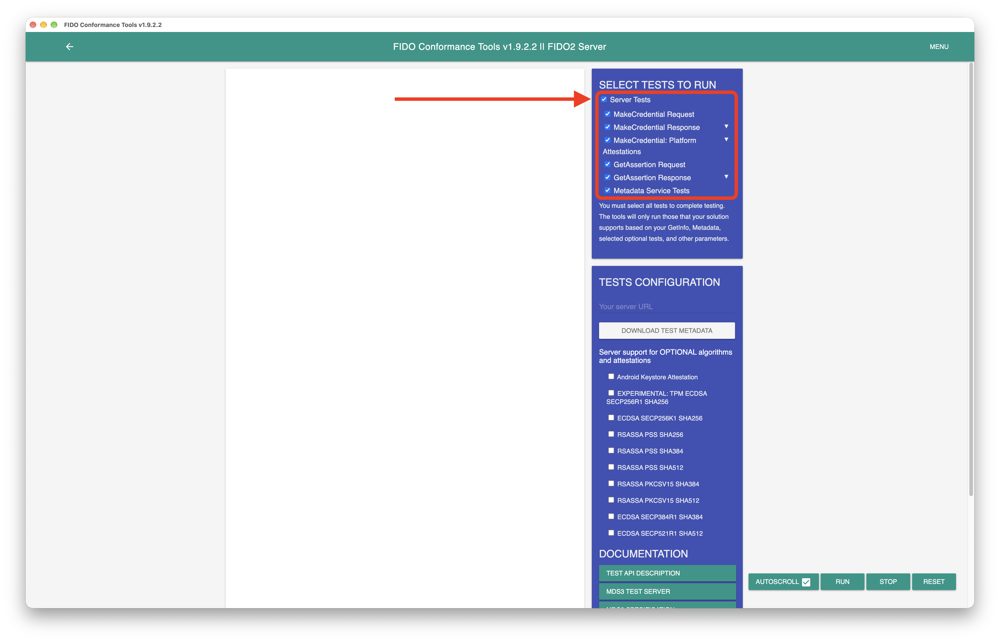
4. In the `"TESTS CONFIGURATION"` section, enable all options under `"Server support for OPTIONAL algorithms and attestations"`
   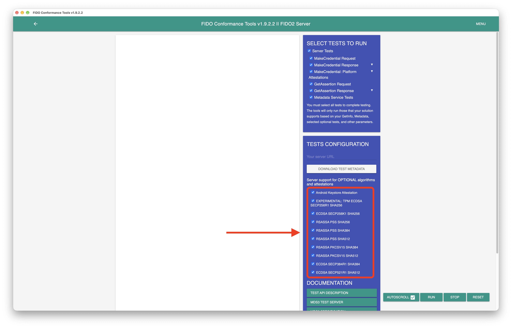
5. In the `"TESTS CONFIGURATION"` section, specify the application URL (by default `https://localhost:5000`)
   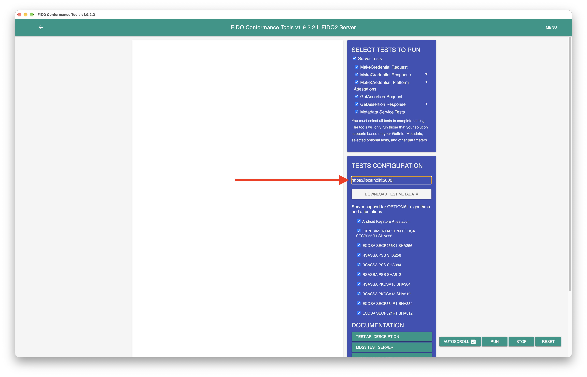
6. Download the test metadata by clicking on the `"DOWNLOAD TEST METADATA"` button.
   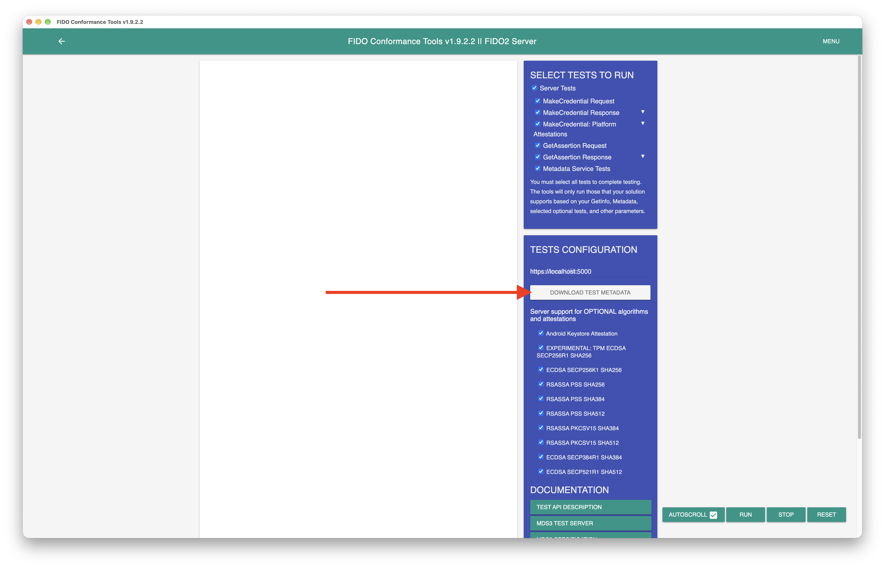
7. In the archive with test metadata (`metadata.zip`), there will be a `metadataStatements` folder containing json files. Move them to the `demo/WebAuthn.Net.Demo.FidoConformance/ConformanceMetadata/MetadataStatements` folder. A file that cannot be deserialized into a metadata statement is skipped with a warning in the application log. Values of `vendorPrototypeConfigCommands` outside the uint64 range, which the FIDO Conformance Tools currently ship in one of the statements, are tolerated by the library: such a value is ignored with a warning, and the rest of the statement is used.
8. Click the `"MDS3 TEST SERVER"` button in the `"DOCUMENTATION"` section.
   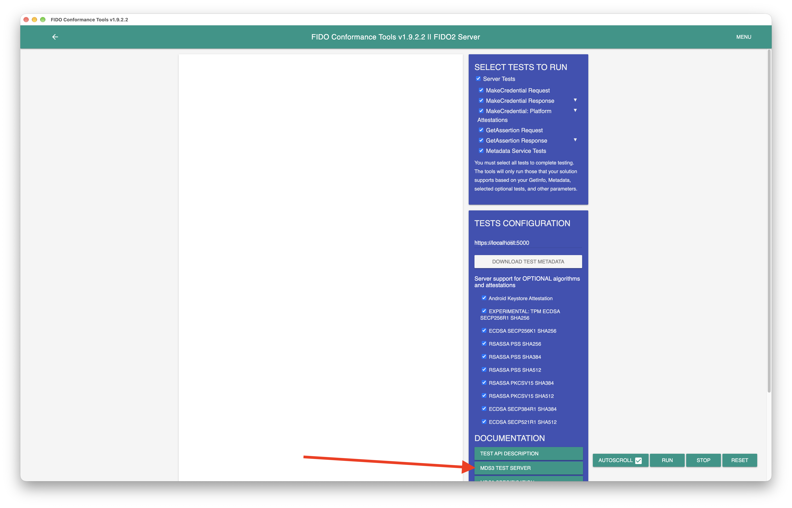
9. On the page that opens, in the `"Server endpoint"` field, enter the application address (by default `https://localhost:5000`).
   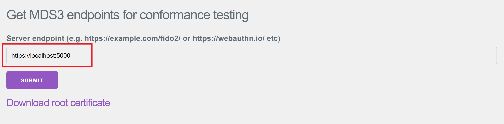
10. Click the `"Download root certificate"` button. Place the downloaded certificate (`MDS3ROOT.crt`) in the `demo/WebAuthn.Net.Demo.FidoConformance/ConformanceMetadata/RootCertificate` folder.
    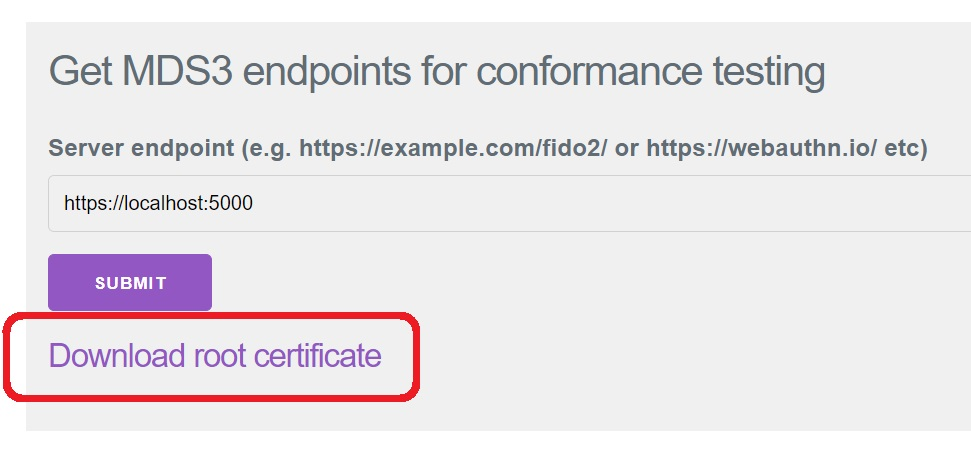
11. Click the `"SUBMIT"` button, after which you will receive 5 links to different files. Download them and place them in the `demo/WebAuthn.Net.Demo.FidoConformance/ConformanceMetadata/Jwt` folder.
    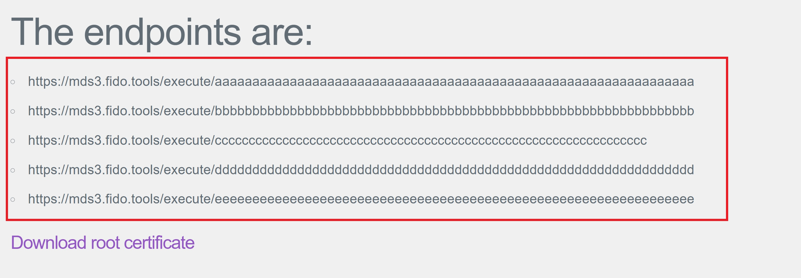
    > **Note on revocation checking.** One of the 5 blobs is signed by a revoked certificate, so the revocation status of the blob signing chain must be known to pass the tests. The certificates of the MDS3 test server publish only CRL distribution points, and only over HTTPS (`https://mds3.certinfra.fidoalliance.org/crl/...`). The .NET chain engine on Linux downloads CRLs only from plain `http://` URLs, and on macOS it does not download CRLs at all (Apple's trust engine uses OCSP only), so with the library's default chain policy every test blob would be rejected there with `RevocationStatusUnknown`. Therefore the demo disables the revocation check of the chain engine for the blob signing chain (`ConformanceCrlRevocationChecker.ConfigureFidoMetadataBlobJwtChain`) and checks the revocation itself: `ConformanceCrlRevocationChecker` downloads the CRLs from the distribution points of the chain certificates, verifies their signatures and rejects the chain if a certificate is revoked or its CRL cannot be obtained. The hook for this is `DefaultFidoMetadataProvider.ValidateJwtCertificateChainAsync`, overridden in `LocalFilesFidoMetadataProviderForMdsTests`. Outbound HTTPS connections to the CRL distribution points must be allowed.
12. Execute the instructions from the section ["Starting the test application"](#starting-the-test-application).
    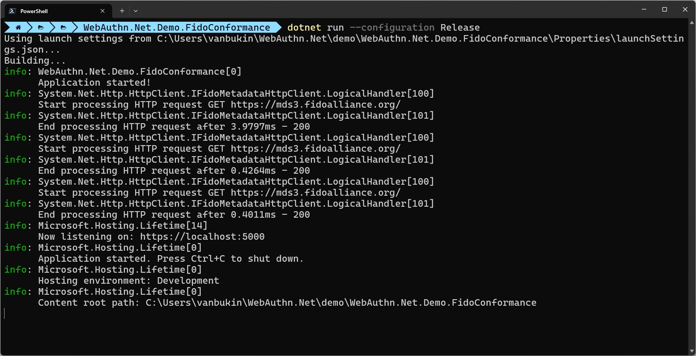
13. Press the `"RUN"` button.
    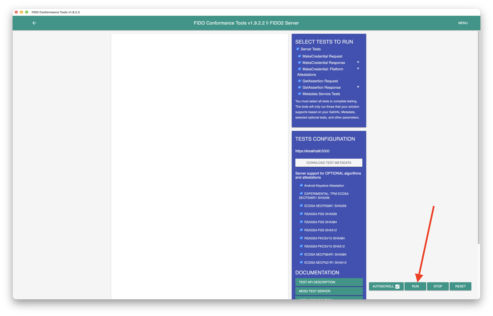
14. All tests should complete successfully.
    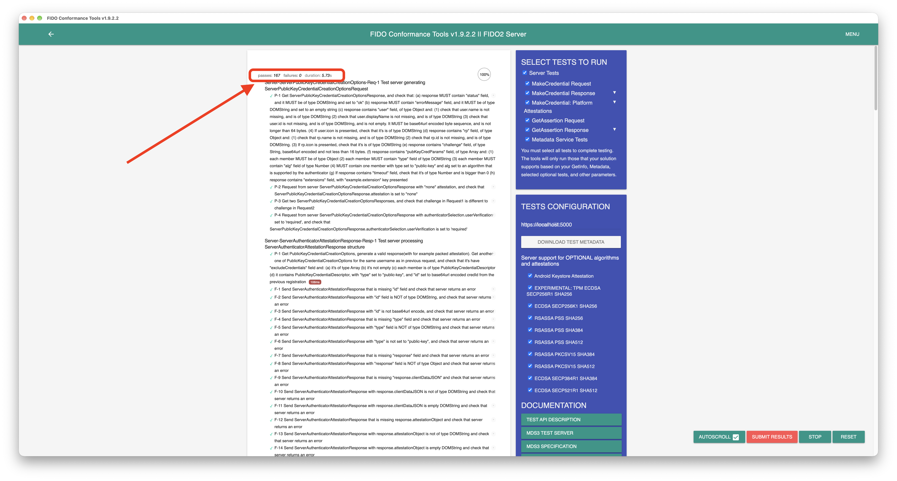

### Starting the test application

1. Navigate to the `demo/WebAuthn.Net.Demo.FidoConformance` directory.
2. Execute the following command:
   ```shell
   dotnet run --configuration Release
   ```
3. You should see the logged message "Application started!" in the console.
